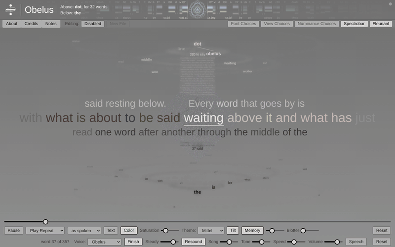
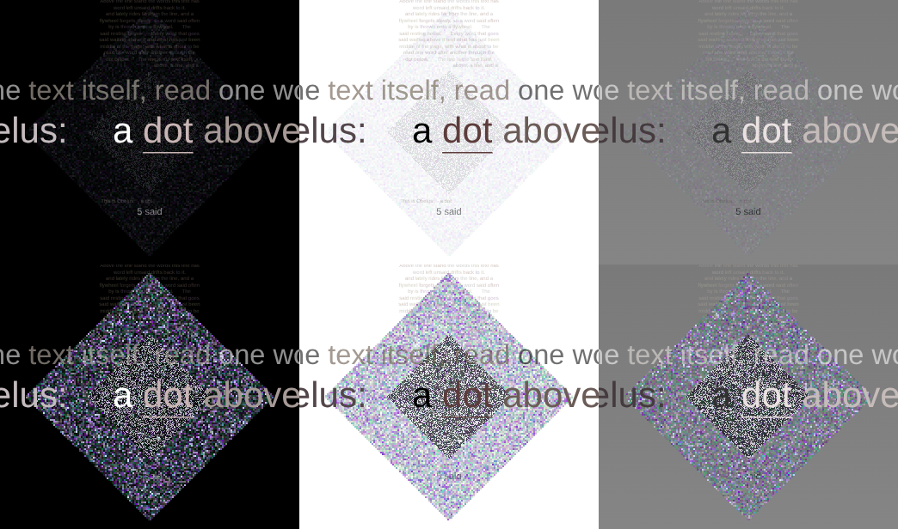
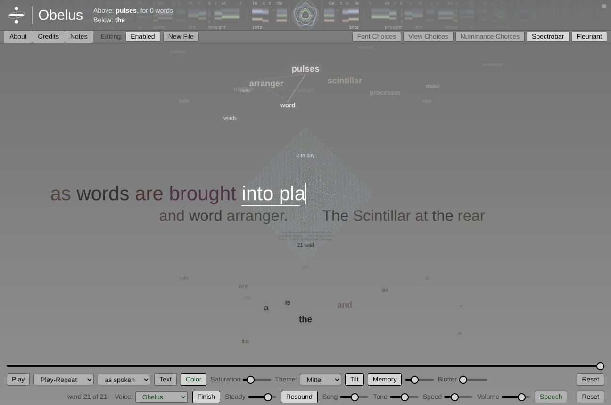
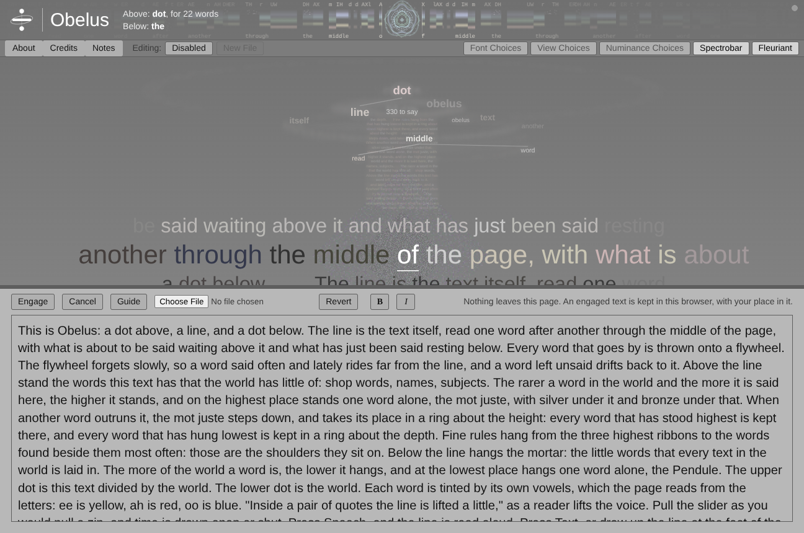
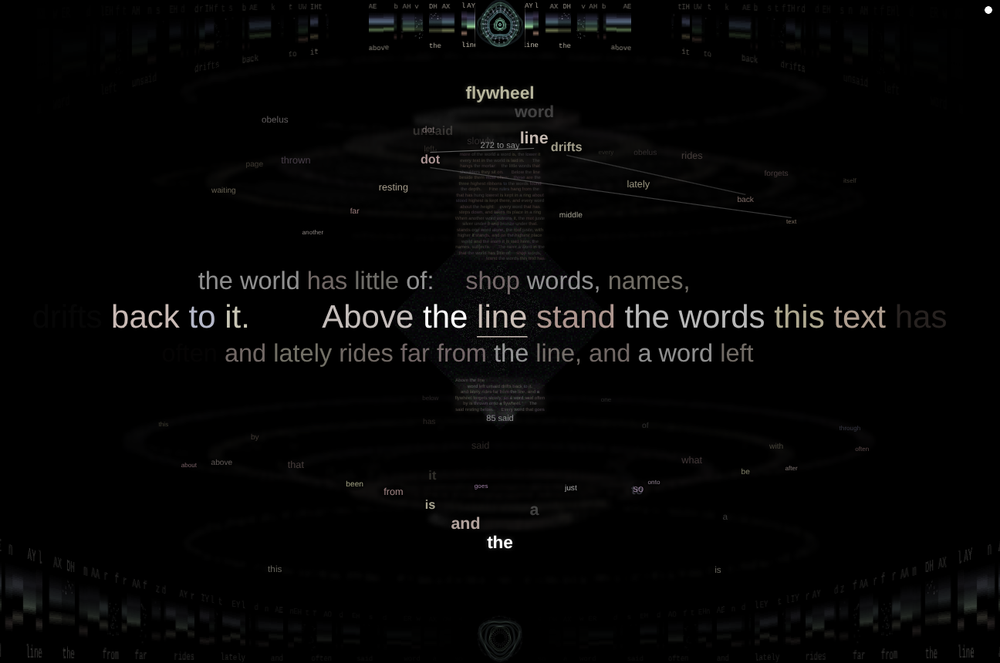

# Obelus

**A text viewer and reader in one file.** The text runs through the middle of the page as a line of type. Its rare words rise above the line, its common words sink below, and a small voice reads it aloud. Open it and it begins; nothing leaves the page.

## **[Open Obelus](https://silberpunkt.github.io/obelus/)**

*One file, nothing to install, nothing fetched, nothing sent anywhere. Save the page and it works from your disk.*

---

## What it does

- **The line.** The text is read one word after another through the centre, with what is about to be said waiting above and what has just been said resting below. Time on this page is distance along that line. Click it to stop and go; hold it and throw it either way.
- **Above and below.** Every word that passes is thrown onto a flywheel that forgets slowly. A word this text says often and the world says seldom rises, to one word alone at the top: the mot juste. The little words every text is laid in hang below, down to one: the Pendule.
- **Colour.** Each word is tinted by its own vowels, read from its letters: ee is yellow, ah is red, oo is blue.
- **The voice.** Press **Speech** and the line is read aloud by Ecouter, a small formant voice that rides in the page. The line is a tape and the centre is the head: drag it and the voice goes with it, backward too. Eight voices, a slider from speech to song.
- **Your own text.** Press **Text**, or draw up the line at the foot of the window, and paste, drop or choose a text. **Engage** reads it in. It is kept in your browser, with your place in it.
- **Editing.** Turn on **Editing** and click between two letters of the halted line. The line slips until that place is under the bar, and the keys are yours. A space says the word just closed; a full stop says the sentence.
- **The Numinance.** Under the word being said lies the Scintillar, a lozenge of single pixels that turn over every frame, and beneath it the Ruglet, which keeps each pixel's memory in colour. Both are meant to be set at the edge of sight.
- **Three grounds.** Night, Day, and Mittel, a middle grey with light above the line and shade below. The dot at the upper right puts the bars away.

## Four pictures

*The Numinance on its three grounds. Above, as the page opens: barely there. Below, turned full up, to show what is there.*

*New File. A clean sheet, the bar at the centre, and the first words finding their places as they are typed.*

*The Text window, drawn up from the foot like a second screen. Write below; watch above.*

*The bars put away, on Night. The strip of the voice's sound flares outward above, and is gathered in again at the foot.*

## What is here

| File | What it is |
|---|---|
| `index.html`, `obelus.html` | The page. The same file twice: one for the address, one to save by name. |
| `obelus.yowl.yaml` | Its handbook: twenty-five cards, one for each part. Any YOWL reader opens it; it is also plain to read as text. |
| `kinescope.html`, `kinescope-cake.html`, `fonts/` | Its two ancestors, kept as they were. |
| `__IOU/` | What Obelus owes back to the work it stands on: four notes to Ecouter, with samples. Paid ones come to rest in `__IOU/__paid`. |
| `ATTRIBUTION.md`, `LICENSE` | What it stands on, and the terms. |

## How it is made

No build, no framework, no server. The page is plain JavaScript drawing on nine canvases, with a voice, a typeface and a table of how common words are, all inside it. **Notes**, in the page's own menu, tells how each part is done, briefly and plainly.

## Credits

Created by User1 and eniamb, November 2026. An homage to the work of MIT's Muriel Cooper, who showed how to navigate and command rich information on a computer. The voices come from [Ecouter](https://github.com/silberpunkt/ecouter); the strip and the fleuriant from [Nuage](https://github.com/silberpunkt/nuage); the world's rate for each word from [wordfreq](https://github.com/rspeer/wordfreq), by Robyn Speer. The page's own **Credits** says the rest.

## Licence

MIT. See [ATTRIBUTION.md](ATTRIBUTION.md) for what it stands on.
